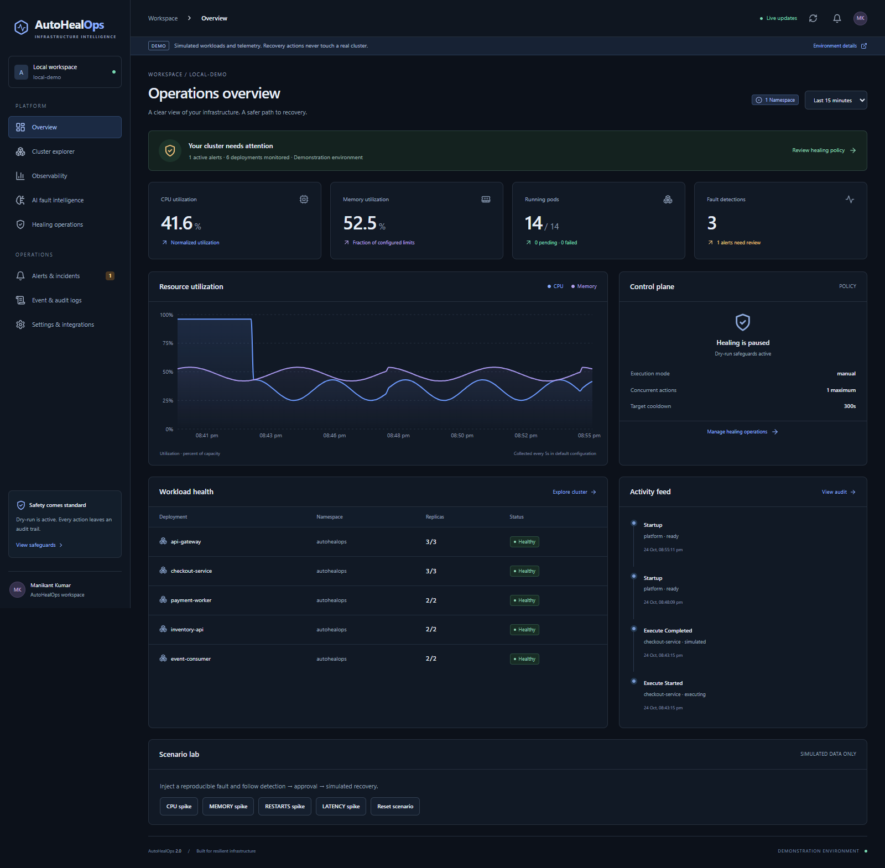
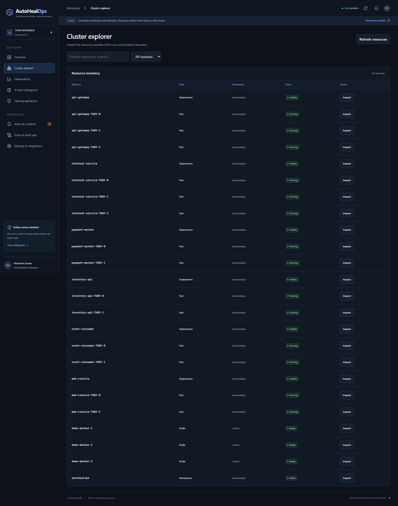
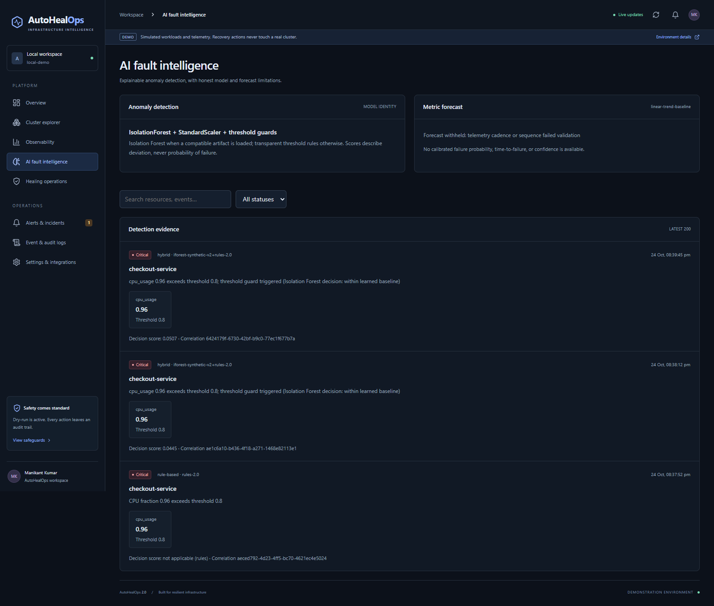
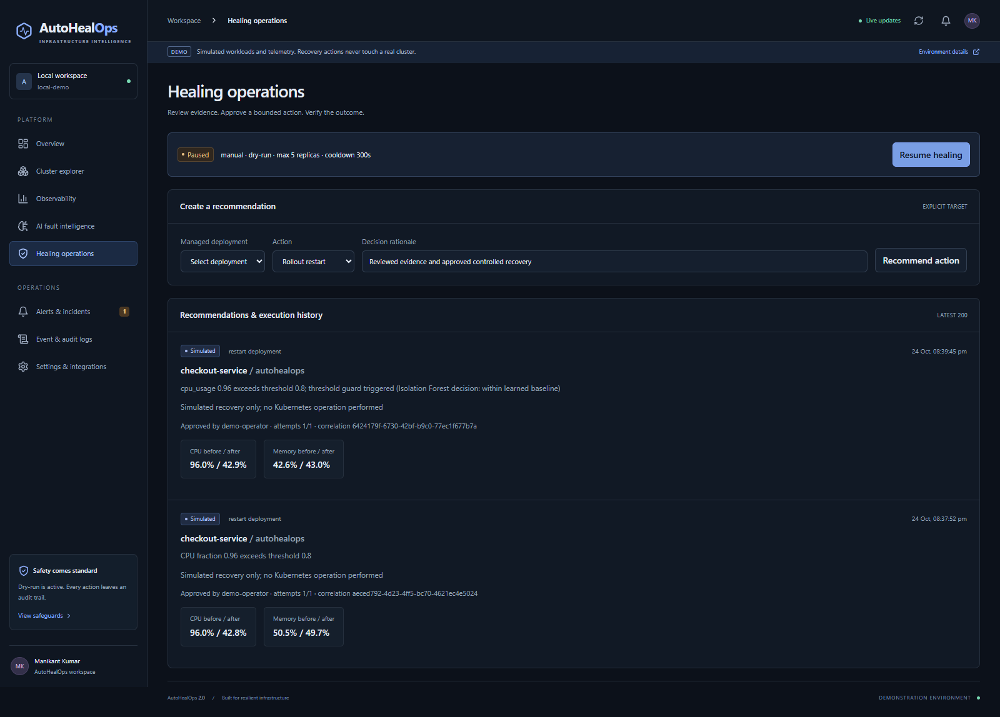
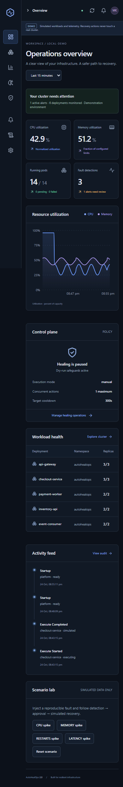
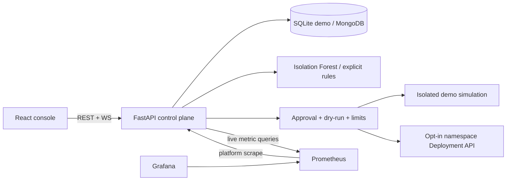

<!-- Animated Header -->
<p align="center">
  
</p>


## AutoHealOps 2.0

**Infrastructure intelligence. Explainable faults. Guarded recovery.**

   

AutoHealOps is a locally runnable operations console for exploring Kubernetes workloads, inspecting telemetry, detecting unusual behavior and reviewing bounded recovery actions. It ships with a deterministic, clearly labelled demonstration environment and an optional namespace-scoped live adapter. Author: [Manikant Kumar](https://github.com/manikantbindass).

## Application preview

A genuine screenshot of the compiled React application running locally, with simulated telemetry:



<details><summary>Cluster, fault intelligence, healing and mobile screenshots</summary>






</details>

## What works

- Eight dark-first, responsive console views: overview, cluster explorer, observability, AI fault intelligence, healing, incidents, audit, and settings.
- Deterministic CPU/memory/restart/latency scenarios; one API supplies all UI data. Backend unavailability produces an error, never invented metrics.
- Persistent alerts, anomaly evidence, telemetry, actions and audit events. Native demo uses SQLite; Compose uses MongoDB with indexes/TTL.
- Scaled Isolation Forest training/inference with metadata and synthetic evaluation; explicitly labelled rules when the model/service is absent.
- Chronological CPU/memory trend-versus-persistence forecasting. No invented failure probability, confidence or time-to-failure.
- Approval and dry-run state machine, emergency pause, namespace/ownership checks, replica limits, cooldown, hourly budget, one-attempt actions and idempotent completion.
- Expiring JWT administrator/viewer roles for live/production, validated startup configuration, CORS/WS origin restrictions and login throttling.
- Shared WebSocket operational updates with exponential reconnect; incident acknowledgement/resolution, resource search/detail and filtered audit history.
- Optional Slack/STARTTLS email adapters, platform Prometheus instrumentation and a provisioned Grafana dashboard.

**Optional:** real namespace-scoped Kubernetes inventory and Deployment rollout/scale actions, MongoDB, monitoring profile, Kubernetes examples. They require the actual services and appropriate configuration.

**Planned:** multi-cluster authorization, distributed workers/locks, durable notification outbox, SSO, calibrated failure prediction, immutable audit archive and production-scale verification. Keep the backend at one worker/replica. This laptop deployment is not an HA production control plane.

## Quick start: Windows and Docker

Prerequisites: Git, Docker Desktop in Linux-container mode, Docker Compose v2; about 4–6 GB RAM for core services and internet for image/dependency downloads.

```powershell
git clone https://github.com/manikantbindass/AutoHealOps-Self-Healing-Kubernetes-Cluster-with-AI-Fault-Detection.git
cd AutoHealOps-Self-Healing-Kubernetes-Cluster-with-AI-Fault-Detection
git switch feature/autohealops-2.0
./scripts/setup.ps1
./scripts/run-demo.ps1 -Scenario cpu
# Optional:
./scripts/start-local.ps1 -Monitoring
# Stop while preserving data:
./scripts/stop-local.ps1
```

Setup creates `.env` only if absent, preserves settings, fills blank secret fields without printing them, validates configuration and waits for service health. Core demo also supports `Copy-Item .env.example .env` then `docker compose up --build -d --wait --wait-timeout 240`. Generate the Grafana password before enabling monitoring. Linux/macOS: `bash scripts/setup.sh`.

Docker configuration validates, but Docker's engine was unavailable on the implementation machine; container builds/runtime are pending. The native fallback below was executed and health-checked.

## Verified native Windows path

Python 3.12 and Node 22+ are required. This runs the compiled frontend with a local preview proxy, backend and AI service. No Docker, paid API or Kubernetes cluster is needed.

```powershell
./scripts/start-native.ps1 -Install -BackendPort 18000 -AiPort 18001 -DashboardPort 13000
./scripts/run-demo.ps1 -Scenario cpu -BackendPort 18000 -DashboardPort 13000
./scripts/health-check.ps1 -BackendPort 18000 -AiPort 18001 -DashboardPort 13000
# Stop just these recorded process trees:
./scripts/stop-native.ps1
```

Open **http://localhost:13000**. API documentation: **http://localhost:18000/docs**; AI documentation: **http://localhost:18001/docs**. Native startup forces safe demo settings and uses SQLite, without loading `.env` credentials. Defaults without port flags are 3000/8000/8001; alternate ports were needed on this machine. Logs are in ignored `.local/`. Detailed installation, manual commands and troubleshooting: [setup guide](docs/setup-guide.md).

## Demonstrate a recovery

1. In Overview → Scenario lab, inject a CPU, memory, restart or latency spike.
2. Open AI fault intelligence to inspect real inference evidence and model identity.
3. In Healing operations, review the rationale and approve the recommendation.
4. Resume healing and select **Simulate recovery**.
5. Compare before/after measurements, inspect the audit trail, and resolve the incident.

Demo recovery always says **simulated**, never a real Kubernetes repair. The application starts paused and dry-run. Real mutations require deliberate live configuration, a scoped service account and an opted-in Deployment; see [safety architecture](docs/architecture.md).

## Architecture



```text
frontend/       React Router, Recharts, Axios, Lucide, production nginx
backend/        settings, schemas, API, collector, persistence, policy, adapters, tests
ai-engine/      validated inference, model metadata, explicit training, temporal evaluation
k8s/            scoped RBAC, probes, resources, PVC, optional HPA/Ingress
monitoring/     platform scrape and provisioned Grafana dashboard
scripts/        Windows setup/start/stop/health/demo, native preview, browser E2E
.github/        tests/build/configuration/container CI
docs/           architecture, API contract, models, operations, validation, screenshots
```

## Services and configuration

| Service | Compose/default native | Verified alternate native |
|---|---|---|
| Dashboard | http://localhost:3000 | http://localhost:13000 |
| API docs | http://localhost:8000/docs | http://localhost:18000/docs |
| AI docs | http://localhost:8001/docs | http://localhost:18001/docs |
| Prometheus | http://localhost:9090 (monitoring) | not launched |
| Grafana | http://localhost:3001 (monitoring) | not launched |
| MongoDB | internal DNS mongo:27017 | SQLite file |

| Environment | Purpose / default |
|---|---|
| MODE / ENVIRONMENT | demo / development; live/production enforce credentials |
| JWT_SECRET / ADMIN_PASSWORD / VIEWER_PASSWORD | required strong signing/admin secrets outside developer demo; optional viewer account |
| DRY_RUN / ALLOW_AUTOMATIC / HEALING_MODE | true / false / manual; startup authorization required for automatic |
| NAMESPACE / MAX_REPLICAS | autohealops / 5; one authorization boundary |
| COOLDOWN_SECONDS / POLL_SECONDS | 300 / 5 |
| RETENTION_DAYS | 7, constrained 1–90 |
| MONGO_URI / SQLITE_PATH | Mongo when configured; otherwise demo SQLite |
| AI_URL / PROMETHEUS_URL | service URLs; Compose supplies internal DNS |
| ORIGINS | comma-separated browser origins, exact allowlist |
| REACT_APP_API_URL | build-time API base; defaults same-origin /api/v1 |
| MODEL_DIR | AI artifact directory; trusted local files only |
| SLACK_WEBHOOK_URL | optional validated HTTPS Slack webhook |
| SMTP_HOST/PORT/USER/PASSWORD, EMAIL_FROM/TO | optional STARTTLS email |
| GRAFANA_ADMIN_PASSWORD | generated by setup, private in .env |

Runtime policy is audited; pause resets to safe on restart. Secrets and service URLs are startup configuration, never displayed in settings. UI lists the latest 200 records; API pages inspect up to 1,000 recent records per kind. Retention is bounded; compliance archives are outside this release.

## API and monitoring

Interactive OpenAPI docs are served at the API `/docs` and AI `/docs`. [API contract](docs/api-contract.md) covers versioning, pagination, units, auth and WebSocket messages. Native/model operation details: [AI models](docs/ai-models.md).

`/telemetry` exports request counts, latency histograms, collector freshness, retained anomalies and healing outcomes. The monitoring profile provisions Prometheus and Grafana automatically. Kubernetes workload metrics require kube-state-metrics, kubelet/cAdvisor, resource limits and request histograms; the Compose platform dashboard does not invent those metrics.

Minikube commands and optional TLS ingress are separate in the [setup guide](docs/setup-guide.md). No real cluster, HPA, TLS or NetworkPolicy enforcement was validated locally.

## Tests and builds

```powershell
./.venv/Scripts/python.exe -m pytest backend/tests -q
Push-Location ai-engine
../.venv/Scripts/python.exe -m pytest tests -q
Pop-Location
Push-Location frontend
npm ci
npm test
npm run build
# Running native stack; use installed Edge on Windows:
$env:PLAYWRIGHT_CHANNEL='msedge'
$env:DASHBOARD_URL='http://localhost:13000'
npm run e2e
Pop-Location
docker compose config --quiet
```

On systems without Edge, run `npx playwright install chromium` in frontend, then omit PLAYWRIGHT_CHANNEL. Browser E2E uses actual APIs and modifies only the explicit demo scenario; it captures the five screenshots above. CI checks frontend/backend/AI and Docker builds. Vite/Vitest replace the inherited CRA tooling following its security audit; React and the application libraries are preserved. Dependency audits report remaining findings transparently. Verified locally: 19 backend tests, 12 AI tests, 6 frontend tests, lint/build/configuration checks and real browser recovery workflow passed. Point-in-time npm and Python environment audits reported zero known findings. See [validation](docs/validation.md) for evidence and blockers.

## Security, operations and contribution

Read [security and operations](docs/security-operations.md) for trust boundaries, backups, recovery and production prerequisites. No secrets, kubeconfigs, databases or trained model binaries are committed. Docker binds UI/API/AI/monitoring to loopback, and MongoDB has no published port. Never expose developer demo authentication bypass publicly.

Contributions should add focused regression coverage, preserve honest source labels and keep remediation safeguards explicit. Run the relevant checks and open a feature-branch PR. The original README claimed MIT, but the repository contains no license grant; this upgrade does not invent one. Obtain the author's permission before redistribution under a specific license.

Automatic unapproved execution is restricted to detector-originated demo recommendations. Live actions and operator-created recommendations require explicit approval because live aggregate telemetry does not provide workload-level attribution.

---

<!-- Footer Wave -->
<p align="center">
  
</p>

<p align="center">
  <b>⭐ Star this repo if it helped you! Built with ❤️ by <a href="https://github.com/manikantbindass">Manikant Kumar</a></b>
</p>
