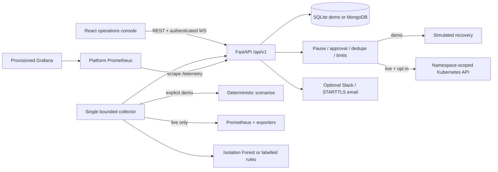

# AutoHealOps 2.0 architecture

The baseline was React 18/CRA + FastAPI with MongoDB, an Isolation Forest, and an untrained LSTM predictor. The upgrade replaces the unsupported CRA build/test toolchain with Vite/Vitest after an actual audit found inherited security vulnerabilities. It retains React Router, Axios, Recharts, Lucide, FastAPI and Kubernetes Python client. It replaces unsupported claims and unsafe mutation paths with explicit, testable boundaries.

## Runtime and data

One API worker owns one collection loop and at most one remediation execution. A single browser provider shares REST state and one reconnecting WebSocket among all eight views. Slow clients are removed rather than blocking the collector indefinitely. No Kafka is needed at this scale. Notifications are optional, timeout-bound and best effort, not a durable delivery queue.

Native demo stores JSON records in SQLite WAL. Compose defaults to MongoDB in a private container network with a persistent volume. MongoDB uses unique `(kind,id)`, time and TTL indexes; startup pings with five bounded retries and the driver reconnects after interruptions. SQLite prunes seven-day records and caps total records at 20,000. Mongo retention defaults to seven days; API queries inspect at most 1,000 recent records per kind and return up to 200 per page. The telemetry retention window is configurable to 1–90 days. Workflow records are retained to the same deadline: longer compliance retention needs a separate immutable audit archive.

Each anomaly opens one deduplicated alert until resolved. An anomaly, alert, recommendation and audit history share a correlation ID. Incident acknowledgement/resolution is operator driven. Demo reset restores healthy metrics and resolves active demo incidents without erasing history. CPU, memory and latency change deterministically by sample index, not wall-clock random numbers. Before/after values are captured at execution.

Live inventory requires only namespace-scoped pods and deployments. It does not claim cluster-wide node visibility. Prometheus queries normalize CPU/memory against configured resource limits; kube-state-metrics, kubelet/cAdvisor and instrumented request histograms are required. Missing exporters produce null measurements while available CPU/memory/restart/latency data is preserved. Incomplete feature vectors use transparent rules on available values; ML and complete-sequence forecasting are withheld. Missing values never become zero or random fallback. Namespace aggregate anomalies create alerts, but cannot identify which deployment to mutate; an operator must select a managed target.

## Remediation trust boundary

Local startup is dry-run, manually approved and paused. Demo always simulates, even if dry-run is changed. Live execution additionally requires `MODE=live`, strong credentials, MongoDB, an authorized service account, a namespace match, and `autohealops.io/managed=true` on the target Deployment. No shell, pod deletion, node drain, namespace deletion, or data-volume operation exists in the control plane.

Allowed mutations: Deployment rollout restart and scaling between 1 and the configured maximum (default 5). The state machine is recommended → approved (or confirmed autonomous policy) → executing → simulated/dry_run/succeeded/failed. Repeated completed requests are idempotent. Pending requests deduplicate by action/namespace/target/replicas. One attempt per action, 300-second target cooldown, ten operations per hour, and one operation at a time limit recovery loops. A restarted process marks interrupted executions failed, never automatically replays them. Kubernetes API calls time out at five seconds; rollout verification waits at most 45 seconds, checking observed generation and updated/available replicas. Metric recovery remains a subsequent telemetry observation, not implied by API acceptance.

Automatic rollout execution requires startup `ALLOW_AUTOMATIC=true`, the automatic policy, and operator resume. Operator-created scaling requires approval; the autonomous CPU runbook may add one replica after confirmed workload evidence. Emergency pause prevents new operations; it cannot undo a mutation already accepted by Kubernetes. Do not grant this role access to production namespaces by default. The previous host kubeconfig mount and standalone autonomous healer are removed.

## Growth and limitations

The API is intentionally single-process. Do not increase backend replicas/workers: in-memory lock/pause/cooldown scheduling would not coordinate across instances. Before horizontal scaling, separate collection/execution workers, implement durable distributed leases/atomic action claims and shared event delivery, and add cluster-specific authorization. Multi-cluster operations, HA, durable notifications, calibrated failure prediction, SSO and immutable external audit storage are planned, not implemented.

MongoDB operations are synchronous and bounded by driver timeouts; high-volume ingestion should move to a dedicated async persistence layer. Dashboard history is capped to the latest 200 samples. Model artifacts must be trusted local files because joblib deserialization is executable. Secrets stay in startup environment/secret references, never settings responses. Local Compose binds public ports to loopback and does not publish MongoDB; production must add Mongo authentication, encrypted transport, private networking, ingress TLS, backups and central secrets management.

Opt-in [autonomous recovery](autonomous-recovery.md) uses exact Deployment ownership, fresh workload measurements and confirmed runbooks for bounded CPU scale-up or rollout restart. Live automatic actions require exact startup targets and both managed/autonomous labels; operator-created actions still require approval. Namespace aggregate detections never choose a target.

## Workload autonomous controller

`services/autonomy.py` runs in a separate background task alongside the shared collector. It queries exact owned Pods for configured Deployments, confirms distinct source samples, selects a scale-up or restart runbook and uses the same serialized executor as manual actions. Execution rechecks the Deployment identity and opt-in labels. Live automatic success also requires two healthy post-action source observations. Failure opens the pause circuit; a retained per-target latch prevents repeat attempts until healthy evidence returns. See [autonomous recovery](autonomous-recovery.md) for exact rules, prerequisites, exclusions and validation boundaries.
